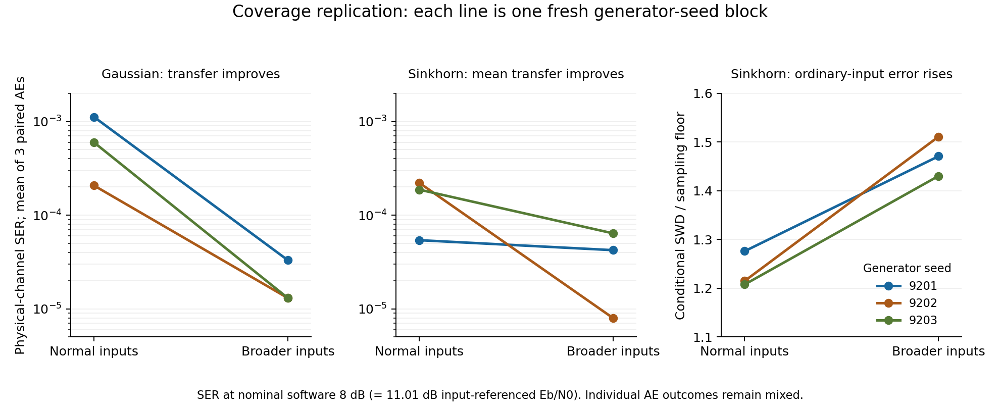

# Independent assessment of the coverage replication and sampler checks

13 October 2026, against commit `b781e0d`. No new training was run in this
assessment. The [completed-results report](coverage_followup_results_20261013.md)
and its frozen data remain unchanged.

## 1. Research decision

The coverage hypothesis now has replication across three fresh generator seeds,
including for Sinkhorn. This is stronger evidence than the original single-model
pilot. The strongest application finding is the reversal between ordinary-input
fidelity and downstream transfer: broad-input Sinkhorn has worse measured SWD
on ordinary inputs in every seed, but better mean nominal-SNR SER in every seed.
Coverage of inputs available to the encoder belongs in the evaluation protocol.

The sampler study also shows that the earlier Flow-8 row was a poor description
of the accuracy available from its trained field. These data justify carrying
a validated finer-resolution flow baseline into the eventual comparison.
Increasing DDIM steps, however, changes direction and magnitude errors
differently; “more steps” is not a universal fidelity repair.

The SSPA noise-label issue is a real calibration issue under the stated
input-referenced convention. Resolve the naming/calibration contract before
external comparison. It does not invalidate comparisons that kept the same
physical noise and input-power normalization.

**Stop the coverage-replication and saved-sampler tasks as completed work.**
The next campaign should use one declared input law across methods, a bounded
sampler-validation allowance, and the still-missing structured channel. A
further open-ended SSPA search would not answer the journal's scope objection.

## 2. Independent verification and limits

The [audit records](evidence/coverage_followup_independent_audit_20261013.json)
are regenerated by:

```bash
python3 Journal_version/figures_src/audit_coverage_followup_20261013.py
```

The audit independently checks all ten exported checksums, result/manifest/report
linkage, 40 frozen local source/protocol hashes, the complete 12-generator and
45-AE grid, matched within-family settings/counts, 135 physical curve points,
per-message symbol/bit totals, all 270 paired discordance records, exported CSV
values, primary generator-block means/SDs, scalar-centering and average power,
six sampler rows, gradient-summary identities, resolution flags and timing means.
It also independently evaluates the ideal Euler recurrence and noise algebra.

All these checks pass. The original preparation tests and checkpoint audits were
reported on the execution host; they were not rerun here. Model checkpoints,
raw gradient vectors and sampler output/Jacobian tensors are absent from this
portable export. In particular, verifying the identity between cosine, norm
ratio and relative error is not an independent regeneration of those vectors.
No raw Jacobian or checkpoint replay is claimed.

## 3. Coverage: the primary effect replicates, with important exceptions

At the **nominal software 8 dB** point, mean SER across the three generator
blocks (each first averaged over its three AEs) is:

| Family | Normal training inputs | Broader inputs | Ratio of means | Improved individual AE pairs |
|---|---:|---:|---:|---:|
| Gaussian | 6.41505e-4 | 1.97093e-5 | 32.55 | 8/9 |
| Sinkhorn | 1.54177e-4 | 3.80410e-5 | 4.05 | 7/9 |

The analytic reference mean is 1.94973e-5. Gaussian's nearby mean does not
establish equivalence to analytic training; the reference is itself a finite
stochastic optimization result. All variants remain development evidence.

The generator-block ratios are informative:

| Generator seed | Gaussian normal/broad SER | Sinkhorn normal/broad SER |
|---|---:|---:|
| 9201 | 33.85 | 1.28 |
| 9202 | 15.90 | 27.84 |
| 9203 | 45.90 | 2.93 |

The “4.05x Sinkhorn improvement” is a ratio of pooled block means, not the
typical per-seed multiplier. Between-generator SD of broad-minus-normal SER
is 4.47e-4 for Gaussian and 1.01e-4 for Sinkhorn. Three generator blocks are
too few for a precise reliability estimate. Neither nine AEs nor a million
evaluation symbols per point converts this into nine independent generators.



### The worsened pairs should remain visible

The new paired evaluation permits a distinction between fitted-codec evaluation
noise and variation caused by training. On the nominal point:

- Gaussian seed 9202 / AE 392020 increases from 13 to 24 errors. The difference
  is about 1.81 times the saved paired Monte Carlo SE.
- Sinkhorn seed 9201 / AE 392011 increases from 35 to 63 errors, about 2.89 SE.
- Sinkhorn seed 9203 / AE 392030 increases from 20 to 63 errors, about 4.84 SE.

These ratios are descriptive, not multiplicity-adjusted significance tests or
training-population inference. The two Sinkhorn degradations should not be
dismissed automatically as simulation noise. Two of its numerical improvements
are also small relative to evaluation noise (about 0.35 and 0.66 SE).

The gains are not uniform across operating points. Gaussian improves all three
generator-block means at all three SNRs. Sinkhorn improves all block means at
nominal 6 and 8 dB, but **seed 9203 worsens at nominal 4 dB**. Across all blocks,
the ratios of normal to broad mean SER at 4/6/8 dB are 1.54/4.23/32.55 for
Gaussian and 1.24/1.73/4.05 for Sinkhorn. The primary nominal-point conclusion
must not become a claim of a universal receiver-robustness improvement.

### What the fidelity reversal means

Sinkhorn ordinary-input SWD/floor rises from 1.208–1.276 to 1.430–1.511 while
its nominal downstream block means improve. Radius-10 mean error improves
strongly, codebooks become less extreme, and surrogate optimism decreases.
This supports a mismatch between the input law used for average fidelity and
the inputs explored by the trained encoder. It is an observed failure of this
metric/protocol as a standalone selector, not a proof that every use of SWD
must fail or that the precise population metric ordering has been certified.

The broad Sinkhorn models still have only 0.562–0.591 of true variance at the
largest tested radius. Gaussian's corresponding ratios are 1.076–1.078. The
intervention improves useful coverage without making Sinkhorn uniformly accurate
throughout the allowed ball. Mean error alone would miss this remaining defect.

All arms retain the physical channel and average-power rule. Broader input
queries use 6.0833 times the expected input energy, so the result assumes the
stated simulator access and equal output counts, not equal RF acquisition
energy. Radial uniformity is not volume uniformity or a certified directional
coverage guarantee. No optimality claim for the chosen mixture follows.

## 4. Sampler results: examine magnitude as well as direction

| Sampler | Variance/truth | Conditional SWD/floor | Encoder cosine | Encoder relative error | Encoder norm ratio |
|---|---:|---:|---:|---:|---:|
| Flow 8 | 0.6012 | 1.911 | 0.9760 | 0.6165 | 0.3992 |
| Flow 32 | 0.9004 | 1.239 | 0.9952 | 0.2366 | 0.7800 |
| Flow 128 | 0.9832 | 1.206 | 0.9937 | 0.1209 | 0.9481 |
| DDIM 20 | 0.8526 | 1.819 | 0.9599 | 0.3945 | 0.6824 |
| DDIM 50 | 0.9812 | 1.723 | 0.9225 | 0.3918 | 0.8558 |
| DDIM 100 | 1.0450 | 1.805 | 0.8848 | 0.4798 | 0.9994 |

These are saved seed-9111 models at one common intermediate codec; analytic
reference resolution checks pass. They are not downstream retraining results.

Flow 128 has a slightly smaller cosine than Flow 32, but approximately halves
relative encoder-gradient error and brings its magnitude closer to the
reference. Ranking these samplers by cosine alone would discard that benefit.
The very small cosine difference does not establish a population ordering.
The earlier Flow-8 variance deficit is substantially a sampler-resolution issue
in this intervention: the weights are unchanged. The exact ideal calculation
below supports this explanation but does not quantify the fraction of neural
error attributable to discretization.

For DDIM 20 to 50, worse direction is partly offset by improved magnitude, so
relative error is nearly unchanged. At 100, relative error is higher even
though the gradient norm is almost correct. Output/Jacobian differences relative
to the finest tested sampler measure internal consistency, not distance to the
physical conditional law or to an infinite-resolution limit.

Sampling times for a **batch of 500** are 1.83/7.00/28.01 ms for Flow and
12.80/32.04/64.14 ms for DDIM. They are neither batch-one latency nor measured
AE-training costs at those new NFEs. Keep Flow-8 and DDIM-20 historical rows;
do not overwrite them with better sampler diagnostics while retaining their
old downstream training times or SERs.

## 5. Exact Gaussian result and the gradient-fidelity implication

The [original calculation](gaussian_flow_discretization_20261012.md) matches the
local independent-endpoint training and left-Euler sampler. The pinned upstream
[affine path](https://raw.githubusercontent.com/facebookresearch/flow_matching/11568d37f8d5a080e12aa7b5305d9c35ae07d136/flow_matching/path/affine.py)
and [scheduler](https://raw.githubusercontent.com/facebookresearch/flow_matching/11568d37f8d5a080e12aa7b5305d9c35ae07d136/flow_matching/path/scheduler/scheduler.py)
use the coefficients 1-t and t. This is not an optimal coupling of the endpoint
distributions merely because the upstream path is named CondOT.

Here is an elementary strengthening, with its scope explicit. At a fixed input
x, let Z~N(0,I), Y~N(m(x),vI) be independent, with constant v>0. Set
\(s(t)=\sqrt{(1-t)^2+vt^2}\). Gaussian conditioning gives the exact population
field
\[
u(t,y;x)=m(x)+a(t)(y-tm(x)),\qquad a(t)=s'(t)/s(t).
\]
Starting from Y_0=Z, uniform left Euler, h=1/N with integer N>=1 and t_i=i/N, yields
\[
Y_N=m(x)+c_N Z,\quad c_0=1,\quad
c_{i+1}=c_i(1+h a(t_i)).
\]
The mean equals t_i m(x) at every grid point by induction.

**Proposition.** For every v>0 and every finite integer N>=1,
\(0\le c_N<\sqrt v\). Thus the ideal Euler sampler is strictly underdispersed.

**Proof.** Strict convexity follows from \(s''(t)=v/s(t)^3>0\). At grid points,
\[
s(t)^2+h s(t)s'(t)
=(1-t)(1-t-h)+vt(t+h)\ge0.
\]
Hence every Euler factor is nonnegative. Strict convexity also gives
\(s(t)+hs'(t)<s(t+h)\), so each factor is strictly less than
\(s(t+h)/s(t)\). Their product is less than s(1)/s(0)=sqrt(v).
For N=1 the factor is zero; for N>1 all factors are positive. This covers the
degenerate one-step case without dividing by a zero Euler factor.

For v=0.052829773..., independent computation gives c_N²/v equal to
0.553289536/0.865956497/0.964715233 for N=8/32/128. The proposition does not
claim monotonicity in N, apply to learned fields, or cover input-dependent
variance, different couplings or higher-order solvers. It is a diagnostic
result, not a claim of new literature-level theory.

**An exact Jacobian is insufficient for an expected-loss gradient.** If m is
differentiable and v is input independent, D_x Y_N=Dm(x), exactly as for a
true conditional sample m(x)+sqrt(v)Z using the same Z. Nevertheless consider
the bounded smooth scalar loss \(\ell(y)=(1-\cos y)/2\) and m(x)=x. Then
\[
\frac{d}{dx}\mathbb E\ell(x+cZ)
=\tfrac12 e^{-c^2/2}\sin x.
\]
The differentiation is justified by the bounded loss derivative. Substituting
c=c_N and c=sqrt(v) gives different gradients whenever sin(x) is nonzero,
although both pathwise input Jacobians equal one. At sin(x)=0 both gradients
vanish. The discrepancy comes from evaluating the loss derivative under
different output laws, not from an incorrect sample Jacobian.

This complements the previous coverage bounds: the relevant input region, the
conditional output law and input sensitivity all matter. It gives neither a
universal SER selector nor an explanation of the exact cross-entropy gradient
direction observed for a trained neural flow. Different Gaussian noise
parameterizations can also have different sample Jacobians while preserving
the entire conditional law and its expected-loss gradients where those
derivatives exist; raw pathwise
Jacobian distance is therefore not a universal solution either.

## 6. Noise convention: preserve results, correct the interpretation

The [noise audit](sspa_noise_label_audit_20261012.md) is algebraically correct.
The nondegenerate normalization used by the saved codebooks gives average input
energy eight for six information bits, so E_b=8/6=1/R. The helper followed by
SSPA's additional 1/sqrt(2) gives real-coordinate variance
\(v=1/(4R\gamma)\), where gamma is the linear software SNR parameter.
Under the explicit convention real noise variance=N0/2,
\[
E_b/N_0=(1/R)/(2v)=2\gamma.
\]
Thus the software points 4/6/8 dB correspond to input-referenced
7.0103/9.0103/11.0103 dB. This is conditional on the declared input-energy
reference; output-referenced energy after the nonlinear amplifier additionally
depends on the learned codebook.

For future work, use input-referenced E_b/N0 as the default contract because
input power is fixed across codecs. Store real noise variance as the primary
physical quantity. Existing records can retain their nominal labels with an
explicit physical-axis conversion; no retraining is needed merely to describe
what was measured. If the intended experiment must instead be at physical
8 dB, it needs twice the current nominal-8 real noise variance, namely
0.105659546..., under a new channel/version ID. Do not modify the frozen runs.

Before launching the paper campaign, add a physical-normalization test derived
from codeword energy/bit count and N0 independently of the existing helper.
Keep normalization floors explicit for degenerate codebooks and audit other
complex-channel conventions separately. A test that only agrees with the
existing simulator cannot detect this factor-of-two convention mismatch.

## 7. Updated handover: close this round and move to the application

1. **Resolve the physical convention once.** Freeze the input-energy/noise
   contract above and label old data correctly. This is preparation for the next
   campaign, not grounds to discard the valid within-setting comparisons.
2. **Adopt the existing broad law as the SSPA comparison condition**, with the
   normal law retained as the coverage ablation. Apply it to all competing
   generators before comparing mechanisms. Do not claim that the law is optimal
   or transfer its radius to another message alphabet/dimension unchanged.
3. **Carry two defensible flow operating points into baseline development:**
   Flow 32 for its speed/accuracy tradeoff and Flow 128 as the finer reference.
   Retain DDIM 20/50 as declared operating points; keep the 100-step negative
   result. A fixed allowance for a higher-order solver is reasonable only if
   competitive-sampler development is still needed. No choice should be made
   from final-paper SER. New NFE downstream claims require new AE training.
4. **Write the larger-channel protocol next, then execute it.** Specify a
   jointly generated wireless block, shared latent state and receiver CSI,
   bandwidth/block length, input and noise energy conventions, oracle access,
   codebook constraints, Gaussian versus non-Gaussian references, and analytic
   communication evaluation. Choose the physical model before selecting a
   generator-favorable metric. Preserve the requested optical-fiber comparison
   as a separate bounded follow-up; it remains unexecuted.
5. **Update paper claims now at the planning level.** The supported story is
   stable one-shot simulation plus coverage-aware validation and competitive
   accuracy/cost tradeoffs. Gaussian's success on a Gaussian conditional law
   is a required reference. Original conditional W-Flow remains prior work;
   neither the coverage fix nor these elementary proofs establish a new
   conditional transport principle. Broad superiority and automatic downstream
   model selection remain unsupported.

The measured completed training cost here is 1081.02 generator seconds plus
1581.40 AE seconds, excluding evaluation and other overhead. No extrapolated
future timing or new cluster submission is part of this assessment.
